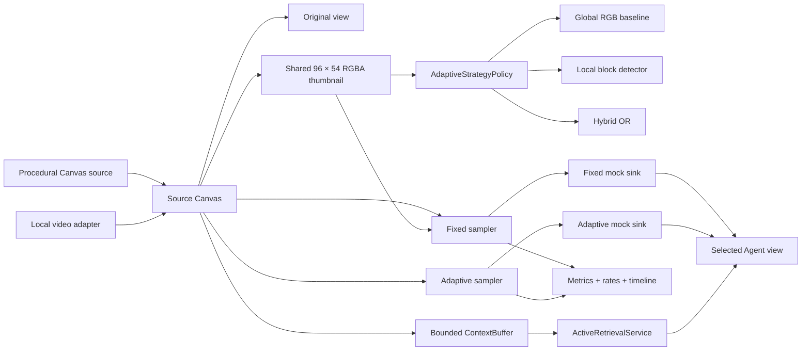

# Architecture

SemanticStream selects context from a live stream for an AI agent operating under limited bandwidth and compute. Phase 0 sampled a procedural visual stream and delivered selected frames to an in-browser mock agent. Phase 1A added a local video adapter that produces the same `StreamFrame<VisualFrame>` sequence. Phase 1B adds a deterministic, budget-aware event evaluation with global, local-block, and hybrid adaptive policies. Phase 2 adds a bounded history buffer and an active retrieval protocol with separate and combined resource budgets.

## Runtime path

Only one source is active. The procedural source draws its deterministic scene into the source Canvas. The video adapter draws the current video frame into the same Canvas, letterboxed to 720 × 405. Both call the same synchronous frame listener. Both samplers evaluate exactly the same capture sequence at runtime. Each has its own policy state, budget, metrics, rates, and mock sink. Selecting an agent view changes which sink and metrics row are visible.

| Concept | Phase 1B contract |
| --- | --- |
| `StreamSource<T>` | Calls a synchronous listener and supports start and stop. The procedural adapter aims for 30 captures per second using `requestAnimationFrame`. The video adapter uses `requestVideoFrameCallback` when available and a `requestAnimationFrame` fallback otherwise. |
| `StreamFrame<T>` | A one-based sequence, a monotonic capture timestamp in milliseconds, and the adapter's payload. The source Canvas is borrowed until the listener returns. |
| `VisualFrame` | The borrowed source Canvas, a source position (`elapsedMs`), optional video `mediaTimeMs`, monotonic `sessionElapsedMs`, and a phase (`Still`, `Slow motion`, `Fast motion`, `Text event`, or `Video`). |
| `ChangeDetector<Sample>` | Mean absolute RGB channel difference, normalized to 0–100%, on matching RGBA thumbnails. `meanRgbDifference` remains the baseline. The shared adapter creates one 96 × 54 sample per input frame. |
| `BlockChangeDetector` | Splits a matching 96 × 54 sample into configurable blocks, computes the same RGB-only normalized difference per block, and reports the maximum difference and the number of changed blocks. Edge blocks may be smaller. |
| `SamplingPolicy<Sample>` | Observes the current sample, session origin, and last delivered sample and timestamp. Fixed sampling targets four 250 ms slots per second. Adaptive sampling compares the current thumbnail with the last one accepted by its sink. |
| `AdaptiveStrategyPolicy` | Selects `global`, `local`, or `hybrid` without replacing the `Sampler`. Hybrid means global change OR changed local blocks. Threshold and block-size setters apply on the next frame. |
| `BudgetController` | Enforces a rolling cap in frames per five seconds. The default cap is 20. A delivery exactly 5,000 ms old has expired. |
| `ContextSink<T>` | Returns whether it synchronously accepted the frame. Each mock sink copies accepted images into its own display Canvas, replacing its previous image. |
| `VideoSource` | Owns the video element listeners, the local Object URL, frame-callback handles, and the `HTMLVideoElement` → Canvas capture path. `dispose()` releases all of them; `stop()` only pauses capture. |
| `SamplingSession` | Owns both samplers, both mock sinks, the shared thumbnail reader, the adaptive strategy policy, the bounded decision timeline, and the rolling rate meters for one uninterrupted comparison session. |
| `Benchmark replay` | A browser-independent Node/browser-neutral runner that feeds deterministic `ReplayFrame` samples into separately constructed samplers. Event labels are held outside the replay input. |
| `ContextBuffer` | Session-scoped, bounded history of owned 96 × 54 RGBA copies. Enforces max age, max frames, and max bytes; supports latest, sequence, timestamp, range, and region lookups with explicit availability statuses. |
| `ActiveRetrievalService` | Applies a retrieval budget and a combined real-time + retrieval budget, logs bounded request/response records, and returns typed results with session IDs, ranges, latency, and budget snapshots. |
| `RollingResourceBudget` | Rolling frame/byte ledger used for retrieval-only and combined budgets. Recording a real-time send is explicit; retrieval cannot spend beyond either limit. |
| `MetricsCollector` | Keeps cumulative counts, per-reason filtered counts, and mean processing latency in constant space for each strategy. |

## Online decisions and time

The procedural adapter samples its deterministic scene using animation time. It stamps a frame with `performance.now()` immediately after drawing. Stream timestamps are nondecreasing within a session and are independent of wall-clock time. RAF capture emits at most one frame per callback. If callbacks pause or miss a slot, capture resumes at the current scene time and skips missed input. Policies can access only the frame being processed and the acceptance state from earlier frames.

The video adapter stamps every emitted frame with `performance.now()`. That value is the sampler's ordering clock. Video media time is a separate field used for display and seek state. It can jump backward or forward when the user seeks, so a load, seek, or restart starts a new sampling session instead of feeding a backward timestamp to a sampler.

The sampler requests delivery for the first frame, for an available frame arriving at least 1,500 ms after the last delivery, or when the selected policy requests it, in that order. Fixed slots are anchored to the first input timestamp and allow a single policy-driven send per slot. A slot without an acceptable frame can expire. Adaptive delivery triggers when the selected rule returns true. Comparing against the last accepted frame lets successive small changes accumulate.

The hard minimum of 125 ms applies to all candidates after the first delivery. A candidate then needs a free slot in the rolling budget. A full budget or busy sink can extend silence beyond 1,500 ms. Candidates are discarded immediately and all gates are checked again on the next arrival. A rejected candidate consumes neither budget nor the adaptive baseline.

## Local block detection and strategy composition

`meanRgbDifference` remains the baseline. `BlockChangeDetector` adds a spatially local rule without changing the stream contract:

1. The 96 × 54 RGBA sample is divided into a configurable grid (6, 8, or 12 pixel blocks in the UI; any positive block size in the core).
2. For each block, the sum of absolute RGB differences is normalized by the block's pixel count and 255 per channel, giving a 0–100% block difference.
3. A block counts as changed when its difference is at least the configured local threshold.
4. The local policy triggers when at least `minChangedBlocks` blocks changed. The default is one changed block.

The detector reads only the last accepted sample and the current sample. It receives no event regions, event labels, or future frames. Edge blocks are clipped to the sample dimensions. Alpha is ignored, matching the baseline's RGB-only definition.

`AdaptiveStrategyPolicy` owns one global `AdaptiveSamplingPolicy` and one `LocalSamplingPolicy`:

- `global` uses only the whole-frame mean RGB difference.
- `local` uses only the block detector.
- `hybrid` returns global OR local, short-circuiting when global already triggers.

The strategy is mutable inside the policy object, so switching the live strategy does not replace the `Sampler` or reset either branch. The last accepted sample is still the baseline for the next decision. The rolling budget, minimum interval, silence refresh, metrics, and sink are unchanged.

## Video lifecycle

`VideoSource` is a three-layer adapter: media element, capture scheduler, and Canvas frame producer.

- **Load.** `videoFileProblem` rejects empty files, unknown extensions, and MIME types the browser reports via `canPlayType`. A valid file gets a new Object URL. The previous URL is revoked only after the new `src` is assigned. Load resets the sampling session, clears the source Canvas, and waits for `loadedmetadata` / `loadeddata`.
- **Capture.** In `requestVideoFrameCallback` mode, each presented frame calls the listener once. Repeated callbacks with the same `presentedFrames` value, or a media time within 0.5 ms of the last emitted frame, are suppressed. In fallback mode, `requestAnimationFrame` polls while playing and emits only when the rounded media time changes. Pending callbacks are canceled on pause, seek, load, stop, and dispose.
- **Playback.** Play, pause, restart, and seek are custom controls. The hidden video element is muted and `playsinline` so a mobile browser can start muted playback. If autoplay is blocked, the status asks the user to press Play. Pause cancels capture without resetting sampling state; resume schedules a new callback. There is no catch-up queue for frames presented while paused or hidden.
- **Seek.** A seek cancels the pending callback, suspends capture, resets the sampling session, and assigns `currentTime`. Frames are suppressed until `seeked`; then the target still frame is painted and capture resumes. A seek to the current position still resets. The same path handles a programmatic/native `seeking` event.
- **Switch.** Switching files reuses one adapter and one listener set. `load()` replaces the Object URL, resets the session, and starts capture from the new file.
- **Return to demo.** The app disposes the video adapter, which removes listeners, pauses the element, revokes the Object URL, clears `src`, reloads the empty element, and clears the Canvas. It then creates a fresh procedural source and sampling session.
- **Page lifecycle.** `pagehide` stops capture. If the page is not entering the back-forward cache, the adapter is disposed and the metrics refresh interval is cleared. If `pageshow` restores a persisted page, capture resumes and playback resumes when it was active. A visibility change can cancel and re-request a frame callback without resetting the session.

The app validates a chosen file before switching modes, so a plainly unsupported codec does not tear down an active video. A file that passes `canPlayType` but fails to decode raises a media error, stops capture, and shows a decode message. Codec availability remains browser- and device-specific.

## Bounded diagnostics

Each session owns a `BoundedTimeline` with capacity 150. Every input frame produces one entry containing its sequence, monotonic timestamp, media time (or `null`), and both decisions. When full, the ring buffer overwrites the oldest entry. The timeline never stores images and never looks at future frames.

Input and sent rates use `RollingRate` meters with a two-second window. Until the window fills, a meter divides by the observed span (with a 500 ms minimum) so startup is not reported as an artificially low rate. Storage is separately capped: 600 input timestamps and 200 timestamps per sent meter. These meters are display diagnostics; they do not affect sampling, budget, or delivery.

Filtered reasons are counted by `MetricsCollector` as `policy`, `interval`, `budget`, or `backpressure`. The cumulative counts are independent of the bounded timeline, so the reason totals survive after the timeline overwrites old entries. A new session clears both.

## Deterministic benchmark

The benchmark is deliberately separated from the browser UI:

- `src/benchmark/fixtures.ts` builds replay scenes. Each `ReplayFrame` contains only a sequence, a deterministic timestamp, and an RGBA sample. Event annotations are stored on `BenchmarkScene.events`, not in the frames.
- `src/benchmark/runner.ts` constructs a fresh `BudgetController` and `Sampler` per scene/strategy, feeds the same frames in order, and returns deliveries plus measured processing times. It never passes the event list to a policy.
- The evaluator runs after replay and uses the event labels to compute recall, missed events, first-capture latency, outside-event sends, and an independent budget audit.

### Fixtures

- Six tuning scenes and six held-out evaluation scenes, each six seconds at 30 fps, 96 × 54 RGBA.
- Event families: local high-contrast text, 100 ms brief events, low-contrast region changes, slow whole-frame brightness ramps, a local event during irrelevant background motion, and a capture pause containing a hidden event.
- Tuning and evaluation scenes use different timings, positions, text, and contrast values. The evaluation suite is not used to choose parameters.
- A capture pause removes frames from the replay sequence, so a hidden event has no input frame at all.

### Metrics

- **Inputs**: replay frames evaluated by a strategy.
- **Sent**: accepted deliveries.
- **Event recall**: observable events with at least one delivered timestamp inside `[startMs, endMs)`, divided by observable events. A hidden event inside a capture gap is excluded from the denominator and reported separately.
- **Missed**: observable events with no delivery inside their window.
- **First capture latency**: first delivered timestamp in the event window minus `startMs`, averaged only over captured events.
- **Processing time**: wall-clock time around each `Sampler.process` call. It varies between runs; frame decisions do not.
- **Budget violations**: an independent audit counts a sent timestamp as a violation when the previous deliveries in `(t − 5,000, t]` already reach the frame limit. The sampler should produce zero.
- **Sends outside events**: deliveries outside every labeled event window. This is a diagnostic, not a precision score, because the fixture event set is sparse.

### Parameter selection and artifacts

The tuning suite evaluates a small grid of local thresholds and block sizes for both local and hybrid rules. Selection maximizes the worst-case local/hybrid recall, then total recall, then minimizes sends outside labeled events, then total sends. The chosen configuration is applied unchanged to the evaluation suite.

`npm run benchmark` writes:

- `benchmarks/results/latest.json`
- `benchmarks/results/latest.csv`
- `benchmarks/results/latest.md`
- `public/benchmark/latest.json` for the in-page benchmark panel

The report includes per-scene results, aggregate results, parameter-selection evidence, observable misses, and unobservable events. The evaluation suite is held out; the latest results are committed as generated artifacts.

## Bounded context buffer

`ContextBuffer` is deliberately independent of the DOM and of the UI. It stores frame pixels, never Canvas references.

- A session is identified by `sessionId`. Offering a frame from another session or querying with another session ID is rejected. The app creates a new buffer on video seek, load, restart, source switch, demo restart, and every new sampling session.
- `offer` validates the RGBA dimensions and clones the caller's pixel array. Retrieval returns another clone, so a caller cannot mutate stored history.
- Bounds are enforced in this order: age eviction (`timestamp < now − maxAgeMs`), frame-count eviction, then byte-count eviction. Each reason is counted separately.
- The buffer tracks both the **retained range** and the **captured range**. A request can therefore be distinguished as `available`, `evicted`, `not-yet-captured`, `nonexistent`, or `wrong-session`; range requests can also be `partial` or `invalid-range`, and regions can be `region-invalid`.
- Optional decimation is available, but the live demo and benchmark store every offered frame within the bounds. The live buffer is capped at 3 s / 90 frames / 3 MB; this is explicitly **not** a whole-video cache.
- `dispose()` clears all pixel arrays and marks the buffer disposed. Page exit disposes the live buffer; a back-forward-cache restore keeps it because the page was not unloaded.

The UI offers ownership-safe retrieval by clicking a decision-timeline column, using the frame's sequence. It shows the available range, cache bytes/frames, eviction reasons, request logs, and explicit error states.

## Active retrieval protocol

`ActiveRetrievalService` sits between the buffer and a mock agent:

- `getLatestFrame(sessionId)`
- `getFrameBySequence(sessionId, sequence)`
- `getFrameAtTimestamp(sessionId, timestampMs, toleranceMs?)`
- `getFramesBetween(sessionId, startMs, endMs, {maxFrames})`
- `getRegion(sessionId, locator, {x, y, width, height})`

Every response carries a request ID, session ID, method, status, requested time, measured latency, retained/captured ranges, and a budget snapshot. Frame and range responses include owned pixel copies; region responses include only the cropped pixels and source-frame metadata. Requests are recorded in a bounded log.

The service owns two rolling budgets:

- Retrieval: 6 frames and 2 MB per five seconds.
- Combined real-time + retrieval: 26 frames and 4 MB per five seconds.

The existing real-time sampler keeps its 20 frames / 5 s `BudgetController`. The app calls `recordRealtimeSend` for the selected agent's real-time deliveries. A retrieval is rejected with `budget-denied` if either the retrieval budget or the combined budget would be exceeded; a rejected request consumes no budget. The benchmark independently audits all three limits.

The live page uses this protocol for timeline retrieval and a 24 × 16 region crop. It does not claim that the mock agent is a model.

## Phase 2 benchmark

The Phase 2 benchmark reuses the Phase 1B fixtures and the same 30 fps, 96 × 54 samples. It compares:

- **A** fixed 4 fps.
- **B** adaptive local.
- **C** adaptive local plus cue retrieval.
- **Oracle** adaptive local plus label-timed retrieval.

C is the only candidate for autonomous behavior. Its cue is a real-time sampler decision of `budget`; it requests the latest buffered frame with a minimum spacing selected on the tuning suite. It never reads event labels or future frames.

The oracle uses event midpoint labels to request a frame. It is an upper-bound experiment only, not autonomous discovery, and is marked as such in JSON, CSV, Markdown, and the page.

The benchmark measures real-time recall, post-retrieval recall, missed events before/after, retrieval frame and byte counts, total sends/bytes, retrieval latency, cache peak, evictions and reasons, and real-time / retrieval / total budget violations. It focuses on the Phase 1B `eval-motion-text` failure where background motion exhausted the real-time budget. The generated artifacts are `benchmarks/results/phase2.json`, `.csv`, `.md`, and `public/benchmark/phase2.json`.

Events entirely inside a capture gap remain unobservable. The oracle cannot recover them either. Retrieval can only return a frame that was captured and is still retained.

## Concurrency, ownership, and measurement

Capture, thumbnail preparation, both decisions, and sink copies run synchronously on the browser main thread. There is no frame queue or catch-up work. A busy sink can decline a candidate via its return value. A slow synchronous sink delays the animation or video callback and can reduce the capture rate for both branches. Future asynchronous sinks will need explicit ownership transfer and a bounded overflow policy.

A capture reuses the original source Canvas. The renderer, thumbnail Canvas, two mock-sink Canvases, the hidden video element, and a constant number of thumbnail samples are the retained media. The history buffer adds a bounded set of owned RGBA copies, never borrowed Canvas references. The video element owns its decoder. `VideoSource` owns the Object URL and media listeners; the app owns the source and session lifetimes. The rolling budget keeps a bounded set of recent delivery timestamps. Stopping or restarting cancels the active callback. Restart or seek clears the sink views and drops the old samplers and their retained samples. Canvas and decoder storage are managed by the browser. The stream stops on page exit.

The reported mean processing latency includes the shared thumbnail preparation once per branch and that branch's synchronous decision and any accepted Canvas copy. It excludes scene or video rendering, the other branch's work, and UI updates. Input counts are captured frames each sampler evaluates; both samplers see the same sequence. Filtered share is (input − accepted) / input. It includes policy omissions, interval and budget blocks, and sink declines.

The benchmark processes one scene at a time and retains only the current scene's samples, delivery list, processing samples, and decisions. Its arrays are bounded by fixture length. The generated JSON/CSV/Markdown files are static artifacts; the app does not run the benchmark in the browser. The dashboard's processing numbers are wall-clock diagnostics, not token or cost measurements.

## Limits

Low-area changes, brief text, and RGB changes attenuated by downsampling can fall below a global threshold. A local block detector can react to irrelevant local motion as readily as to a labeled event. The benchmark demonstrates one such failure: background motion consumes the rolling budget before a later event, so local and hybrid miss it even though they send many frames. A fixed schedule, a compressed local event, or a capture gap can also hide an event entirely. Maximum silence provides refresh opportunities and cannot recover an event.

Recall measures only whether a frame was delivered inside a defined visual event window. It does not measure whether a vision model or language model understood the event, and it does not measure task success. The synthetic fixtures are small, 96 × 54, and intentionally sparse. The event labels are evaluator-only; a real deployment would need an independent labeling and evaluation pipeline.

Phase 2 does not implement a whole-video archive, GPU inference, model APIs, a backend, or a semantic understanding model. The buffer is a short-lived evidence cache, not a replacement for the source. The oracle result is not evidence of autonomous event discovery. Later work may add opt-in sources, asynchronous sinks, and broader resource policies.
