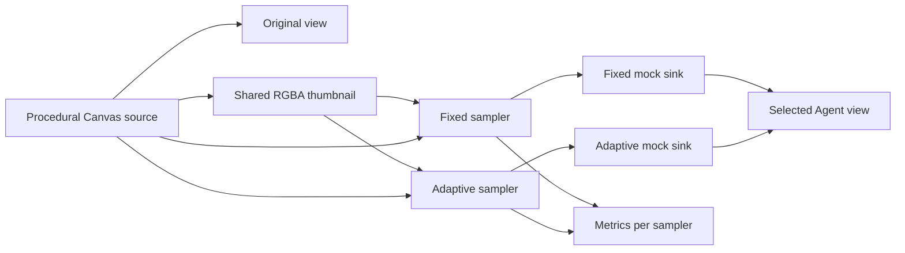

# Architecture

SemanticStream selects context from a live stream for an AI agent operating under limited bandwidth and compute. Phase 0 samples a procedural visual stream and delivers selected frames to an in-browser mock agent.

## Runtime path

Both samplers process exactly the same capture sequence at runtime. Each uses its own acceptance history, budget, metrics, and sink. Selecting a mode changes which sink and metrics are visible. Budget updates apply to both samplers and preserve previous sends. Restart begins a new session from the beginning of the same scene and keeps the control settings.

| Concept | Phase 0 contract |
| --- | --- |
| `StreamSource<T>` | Calls a synchronous listener and supports start and stop. The procedural adapter aims for 30 captures per second using requestAnimationFrame. |
| `StreamFrame<T>` | A one-based sequence, a monotonic capture timestamp in milliseconds, and the adapter's payload. The source Canvas is borrowed until the listener returns. |
| `ChangeDetector<Sample>` | The visual implementation computes mean absolute RGB channel difference, normalized to 0–100%, on matching RGBA thumbnails. The Canvas adapter creates one 96 × 54 sample per input frame. |
| `SamplingPolicy<Sample>` | Observes the current sample, session origin, and last delivered sample and timestamp. Fixed sampling targets four 250 ms slots per second. Adaptive sampling compares the current thumbnail with the last one accepted by its sink. |
| `BudgetController` | Enforces a rolling cap in frames per five seconds. The default cap is 20. The sampler enforces delivery spacing and schedules silence refreshes. |
| `ContextSink<T>` | Returns whether it synchronously accepted the frame. Each mock sink copies accepted images into its own display Canvas, replacing its previous image. |
| `ContextBuffer` | Reserved for bounded storage and explicit retrieval by sequence or time range. Phase 0 has no raw frame archive, retrieval interface, or buffer stub. |
| `MetricsCollector` | Keeps cumulative counts and mean processing latency in constant space for each strategy. Metrics reset when the session restarts. |

The sampler accepts a source payload and a policy-specific sample as separate type parameters. Other stream adapters can choose their own payload, observation, and policy while sharing delivery, budgeting, and metrics.

## Online decisions and time

The Canvas adapter samples its deterministic scene using animation time. It stamps a frame with `performance.now()` immediately after drawing. Stream timestamps are nondecreasing within a session and are independent of wall-clock time. RAF capture emits at most one frame per callback. If callbacks pause or miss a slot, capture resumes at the current scene time and skips missed input. Policies can access only the frame being processed and the acceptance state from earlier frames.

The sampler requests delivery for the first frame, for an available frame arriving at least 1,500 ms after the last delivery, or when the selected policy requests it, in that order. Fixed slots are anchored to the first input timestamp and allow a single policy-driven send per slot. A slot without an acceptable frame can expire. Adaptive delivery triggers when mean RGB change meets the threshold, which defaults to 1.5%. Comparing against the last accepted frame lets successive small changes accumulate.

The hard minimum of 125 ms applies to all candidates after the first delivery. A candidate then needs a free slot in the rolling budget. The count at time t includes earlier deliveries in the interval (t − 5,000 ms, t]. A delivery exactly 5,000 ms old has expired. Reducing the cap below recent usage pauses delivery until those timestamps expire. A full budget or busy sink can extend silence beyond 1,500 ms. Candidates are discarded immediately and all gates are checked again on the next arrival. A rejected candidate consumes neither budget nor the adaptive baseline.

## Concurrency, ownership, and measurement

Capture, thumbnail preparation, both decisions, and sink copies run synchronously on the browser main thread. There is no frame queue or catch-up work. A busy sink can decline a candidate via its return value. A slow synchronous sink delays the animation callback and can reduce the capture rate for both branches. Future asynchronous sinks will need explicit ownership transfer and a bounded overflow policy.

A capture reuses the original Canvas. The renderer, thumbnail Canvas, two mock-sink Canvases, and a constant number of thumbnail samples are the only retained media. The rolling budget keeps a bounded set of recent delivery timestamps. Stopping or restarting cancels the active animation callback. Restart clears the sink views and drops the old samplers and their retained samples. Canvas storage is managed by the browser. The stream stops on page exit and resumes if the browser restores the page from its back-forward cache.

The reported mean processing latency includes the shared thumbnail preparation once per branch and that branch's synchronous decision and any accepted Canvas copy. It excludes scene rendering, the other branch's work, and UI updates. Input counts are captured frames each sampler evaluates. Filtered share is (input − accepted) / input. It includes policy omissions, interval and budget blocks, and sink declines. These measures describe browser frame processing and delivery volume.

## Limits

Low-area changes, brief text, and RGB changes attenuated by downsampling can fall below the global threshold. Capture cadence, a fixed slot boundary, a full budget, minimum spacing, or a busy sink can hide a short event entirely. Maximum silence provides refresh opportunities and cannot recover an event. Phase 0 cannot recover omitted content, estimate model token usage, or guarantee event delivery. Other stream modalities, raw-frame retrieval, and remote agents remain future work.
