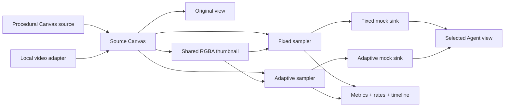

# Architecture

SemanticStream selects context from a live stream for an AI agent operating under limited bandwidth and compute. Phase 0 samples a procedural visual stream and delivers selected frames to an in-browser mock agent. Phase 1A adds a local video adapter that produces the same `StreamFrame<VisualFrame>` sequence, so both sampling policies continue to share one input path.

## Runtime path

Only one source is active. The procedural source draws its deterministic scene into the source Canvas. The video adapter draws the current video frame into the same Canvas, letterboxed to 720 × 405. Both call the same synchronous frame listener. Both samplers evaluate exactly the same capture sequence at runtime. Each has its own policy state, budget, metrics, rates, and mock sink. Selecting an agent view changes which sink and metrics row are visible. Budget and threshold updates apply to both samplers and preserve previous sends.

| Concept | Phase 1A contract |
| --- | --- |
| `StreamSource<T>` | Calls a synchronous listener and supports start and stop. The procedural adapter aims for 30 captures per second using `requestAnimationFrame`. The video adapter uses `requestVideoFrameCallback` when available and a `requestAnimationFrame` fallback otherwise. |
| `StreamFrame<T>` | A one-based sequence, a monotonic capture timestamp in milliseconds, and the adapter's payload. The source Canvas is borrowed until the listener returns. |
| `VisualFrame` | The borrowed source Canvas, a source position (`elapsedMs`), optional video `mediaTimeMs`, monotonic `sessionElapsedMs`, and a phase (`Still`, `Slow motion`, `Fast motion`, `Text event`, or `Video`). |
| `ChangeDetector<Sample>` | Mean absolute RGB channel difference, normalized to 0–100%, on matching RGBA thumbnails. The shared adapter creates one 96 × 54 sample per input frame. |
| `SamplingPolicy<Sample>` | Observes the current sample, session origin, and last delivered sample and timestamp. Fixed sampling targets four 250 ms slots per second. Adaptive sampling compares the current thumbnail with the last one accepted by its sink. |
| `BudgetController` | Enforces a rolling cap in frames per five seconds. The default cap is 20. A delivery exactly 5,000 ms old has expired. |
| `ContextSink<T>` | Returns whether it synchronously accepted the frame. Each mock sink copies accepted images into its own display Canvas, replacing its previous image. |
| `VideoSource` | Owns the video element listeners, the local Object URL, frame-callback handles, and the `HTMLVideoElement` → Canvas capture path. `dispose()` releases all of them; `stop()` only pauses capture. |
| `SamplingSession` | Owns both samplers, both mock sinks, the shared thumbnail reader, the bounded decision timeline, and the rolling rate meters for one uninterrupted comparison session. |
| `ContextBuffer` | Reserved for bounded storage and explicit retrieval by sequence or time range. Phase 1A still has no raw-frame archive or retrieval interface. |
| `MetricsCollector` | Keeps cumulative counts, per-reason filtered counts, and mean processing latency in constant space for each strategy. |

## Online decisions and time

The procedural adapter samples its deterministic scene using animation time. It stamps a frame with `performance.now()` immediately after drawing. Stream timestamps are nondecreasing within a session and are independent of wall-clock time. RAF capture emits at most one frame per callback. If callbacks pause or miss a slot, capture resumes at the current scene time and skips missed input. Policies can access only the frame being processed and the acceptance state from earlier frames.

The video adapter stamps every emitted frame with `performance.now()`. That value is the sampler's ordering clock. Video media time is a separate field used for display and seek state. It can jump backward or forward when the user seeks, so a load, seek, or restart starts a new sampling session instead of feeding a backward timestamp to a sampler.

The sampler requests delivery for the first frame, for an available frame arriving at least 1,500 ms after the last delivery, or when the selected policy requests it, in that order. Fixed slots are anchored to the first input timestamp and allow a single policy-driven send per slot. A slot without an acceptable frame can expire. Adaptive delivery triggers when mean RGB change meets the threshold, which defaults to 1.5%. Comparing against the last accepted frame lets successive small changes accumulate.

The hard minimum of 125 ms applies to all candidates after the first delivery. A candidate then needs a free slot in the rolling budget. A full budget or busy sink can extend silence beyond 1,500 ms. Candidates are discarded immediately and all gates are checked again on the next arrival. A rejected candidate consumes neither budget nor the adaptive baseline.

## Video lifecycle

`VideoSource` is a three-layer adapter: media element, capture scheduler, and Canvas frame producer.

- **Load.** `videoFileProblem` rejects empty files, unknown extensions, and MIME types the browser reports via `canPlayType`. A valid file gets a new Object URL. The previous URL is revoked only after the new `src` is assigned. Load resets the sampling session, clears the source Canvas, and waits for `loadedmetadata` / `loadeddata`.
- **Capture.** In `requestVideoFrameCallback` mode, each presented frame calls the listener once. Repeated callbacks with the same `presentedFrames` value, or a media time within 0.5 ms of the last emitted frame, are suppressed. In fallback mode, `requestAnimationFrame` polls while playing and emits only when the rounded media time changes. Pending callbacks are canceled on pause, seek, load, stop, and dispose.
- **Playback.** Play, pause, restart, and seek are custom controls. The hidden video element is muted and `playsinline` so a mobile browser can start muted playback. If autoplay is blocked, the status asks the user to press Play. Pause cancels capture without resetting sampling state; resume schedules a new callback. There is no catch-up queue for frames presented while paused or hidden.
- **Seek.** A seek cancels the pending callback, suspends capture, resets the sampling session, and assigns `currentTime`. Frames are suppressed until `seeked`; then the target still frame is painted and capture resumes. A seek to the current position still resets. The same path handles a programmatic/native `seeking` event.
- **Switch.** Switching files reuses one adapter and one listener set. `load()` replaces the Object URL, resets the session, and starts capture from the new file.
- **Return to demo.** The app disposes the video adapter, which removes listeners, pauses the element, revokes the Object URL, clears `src`, reloads the empty element, and clears the Canvas. It then creates a fresh procedural source and sampling session.
- **Page lifecycle.** `pagehide` stops capture. If the page is not entering the back-forward cache, the adapter is disposed and the metrics refresh interval is cleared. If `pageshow` restores a persisted page, capture resumes and playback resumes when it was active. A visibility change can cancel and re-request a frame callback without resetting the session.

The app validates a chosen file before switching modes, so a plainly unsupported codec does not tear down an active video. A file that passes `canPlayType` but fails to decode raises a media error, stops capture, and shows a decode message. Codec availability remains browser- and device-specific.

## Bounded diagnostics

Each session owns a `BoundedTimeline` with capacity 150. Every input frame produces one entry containing its sequence, monotonic timestamp, media time (or `null`), and both decisions. When full, the ring buffer overwrites the oldest entry. The timeline never stores images and never looks at future frames.

Input and sent rates use `RollingRate` meters with a two-second window. Until the window fills, a meter divides by the observed span (with a 500 ms minimum) so startup is not reported as an artificially low rate. Storage is separately capped: 600 input timestamps and 200 timestamps per sent meter. These meters are display diagnostics; they do not affect sampling, budget, or delivery.

Filtered reasons are counted by `MetricsCollector` as `policy`, `interval`, `budget`, or `backpressure`. The cumulative counts are independent of the bounded timeline, so the reason totals survive after the timeline overwrites old entries. A new session clears both.

## Concurrency, ownership, and measurement

Capture, thumbnail preparation, both decisions, and sink copies run synchronously on the browser main thread. There is no frame queue or catch-up work. A busy sink can decline a candidate via its return value. A slow synchronous sink delays the animation or video callback and can reduce the capture rate for both branches. Future asynchronous sinks will need explicit ownership transfer and a bounded overflow policy.

A capture reuses the original source Canvas. The renderer, thumbnail Canvas, two mock-sink Canvases, the hidden video element, and a constant number of thumbnail samples are the retained media. The video element owns its decoder. `VideoSource` owns the Object URL and media listeners; the app owns the source and session lifetimes. The rolling budget keeps a bounded set of recent delivery timestamps. Stopping or restarting cancels the active callback. Restart or seek clears the sink views and drops the old samplers and their retained samples. Canvas and decoder storage are managed by the browser. The stream stops on page exit.

The reported mean processing latency includes the shared thumbnail preparation once per branch and that branch's synchronous decision and any accepted Canvas copy. It excludes scene or video rendering, the other branch's work, and UI updates. Input counts are captured frames each sampler evaluates; both samplers see the same sequence. Filtered share is (input − accepted) / input. It includes policy omissions, interval and budget blocks, and sink declines.

The dashboard also shows rolling input and sent rates, the difference in delivered frame counts, and the bounded decision timeline. These measures describe browser frame processing and delivery volume. They are not token, API-call, or cost measurements.

## Limits

Low-area changes, brief text, and RGB changes attenuated by downsampling can fall below the global threshold. Capture cadence, a fixed slot boundary, a full budget, minimum spacing, or a busy sink can hide a short event entirely. Maximum silence provides refresh opportunities and cannot recover an event. A video that is paused, stalled, hidden, or seeking produces no input frames, and there is no catch-up. Codec support and autoplay policy are controlled by the browser. Phase 1A cannot recover omitted content, estimate model token usage, or guarantee event delivery. Raw-frame retrieval, labeled event recall, local-region change detection, and remote agents remain future work.
