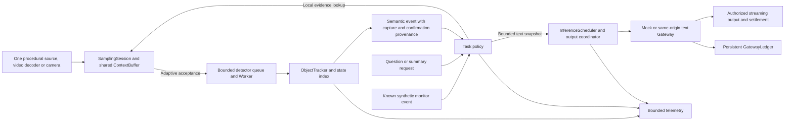

# Phase 4I · Integrated Agent Runtime

Open `/agent.html` from the sampling demo. This page runs one Agent session with either the system monitor, the procedural scene, a local video, or an explicitly opened camera. The detector and text Gateway are separately opt-in. The other three pages remain independent diagnostic tools.



## Ownership and time

`src/agent/session.ts` owns the source lifetime, visual sampling, detection submission, tracking and context reads, policy admission, active inference provider and telemetry scope. The browser entry point adapts Canvas, video and forms. Node replay feeds the same facade through typed frame and detector adapters. A source callback borrows the image. The session reads one thumbnail into the Phase 3R cache and prepares a separate bounded detector tensor only after adaptive sampling accepts the frame and the local detector rate cap permits it. One in-flight detection and one pending latest frame bound the worker path. The cache and history retrieval use the existing visual admission controller.

Each snapshot and trace links a runtime instance, session and source generation. A task configuration or task status change advances the revision and invalidates its predecessor. Source changes, video resets and backgrounding retire the session. Interruption advances the interaction scope; already unsettled inference still waits for reliable upstream terminal evidence. These scope fields are trace identities. They are excluded from ordinary metric labels.

The tracker takes one shared-clock capture time and detection completion time per batch. Observation session, sequence, capture, completion and embedded evidence metadata are validated against the batch. Category keys include detector/model namespace, normalized category name and a known numeric index when available. Older unmatched boxes cannot extend a stationary episode. A missing/failed detection is different from a valid empty batch. Subscriber errors are isolated.

- **Capture** is the time on the retained frame reference.
- **State confirmation** is the completion time of the batch that established the state. History is indexed by when the information was known. Its separate evidence coordinate remains the original capture time.
- **Event production** is the monotonic time the tracker creates the semantic event. The Agent consumes it on the same clock, keeping its own consumption timestamp. A monotonic session event ID rejects duplicate and out-of-order delivery. The policy also rejects stale and superseded events.
- **Historical retrieval** chooses the most recent retained frame at or before the requested time. Exact event evidence checks the session, sequence, frame reference and capture time. Cache presence can be inspected without cloning pixels. The user retrieval action uses the existing budget and returns `available`, `unavailable`, `evicted`, `wrong-session` or `budget-denied`.

## Tasks and providers

Object Watch supports a category or track ID, presence events and optional image movement. Region Watch uses the tracked center and user-supplied image percentages. Scene Summary and questions use a bounded slice of tracked objects, recent transitions and previously completed conversation. System Monitor uses explicit synthetic alert metadata. Pausing or ending the task stops automatic monitoring. Explicit questions remain available. A new question supersedes the previous response.

The default deterministic policy can ignore, wait, retrieve locally, respond, or escalate. A detector score and an ambiguous association are separate inputs. Ambiguity can send the frame to local review without calling the model. Normal events may coalesce. Important relevant transitions can retire lower-priority observations with a recorded reason. Queued work rechecks scope, event age and current state at dispatch. Text snapshots contain the task, selected event, current state, recent state history, evidence timestamps and availability. The existing scheduler owns token holds, physical slots, deadlines and output arbitration. The persistent GatewayLedger remains authoritative for paid admissions. Models produce text only. The runtime exposes no model-driven external action executor.

The static Lab opens in Mock mode and makes no paid requests. The Gateway option is available on the Node gateway's exact loopback origin, with a separate access token held in memory. External URLs are disabled. Use the [Gateway setup](real-streaming-provider.md) for credentials, host checks and spending limits. Pixel payloads stay on device. Detector scores describe a detector result and image-space movement may reflect camera movement. Track expiry leaves physical presence unknown.

Hiding the page or exiting releases camera tracks, stops playback/capture and submits no further detections. It also terminates the detector Worker and disconnects the text Gateway. Foregrounding requires the user to choose a source again. Already accepted upstream calls settle through the original scope.

## Measurements and replay

Scheduler subscriptions deliver admission, dispatch, first authorized output, quarantine and terminal records directly to the bounded telemetry sink. Logical completion and upstream settlement use the reserved critical ring. Late terminals retain their original session/event/request identity. The exporter omits media, prompts, raw model output and credentials. The Lab distinguishes real local perception, fixture events, mock inference and unavailable Gateway cost. When connected, settled, reserved and provisional amounts are configured-price estimates from the server.

```sh
npm ci
npm run typecheck
npm run test
npm run benchmark
npm run benchmark:integrated
npm run gateway:fixture
npm run build
npm run preview
```

The [integrated replay report](../benchmarks/results/phase4i-integrated-agent.md) compares an all-eligible FIFO baseline, task-aware FIFO, and the same policy with context-aware scheduling. The scenarios use the production Agent facade with identical fixture observations, time, hard budgets and two logical slots. Tests cover static clutter, appearance/loss/reappearance, ambiguous association, priority takeover, task revision, stale/duplicate events and output, background retirement, exhausted budget, missing terminal and historical eviction. A valid response measures an authorized partial in a labeled fixture window. Detector accuracy, physical identity and real model cost are outside the fixture metrics.

## Phase 4I-L boundary

`src/agent/provider.ts` defines the capability and readiness contract for a future WebLLM adapter. Start with one execution slot per verified local model, an explicit download/concurrent-memory check, a worker lifecycle and a reliable completion signal. Reuse the output coordinator and scheduler snapshots. A local failure remains local. There is no WebLLM download, local model picker or automatic paid fallback in this phase.
