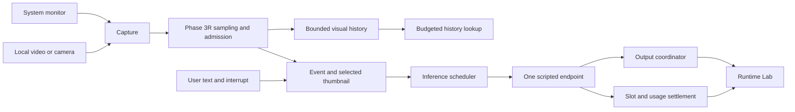

# Phase 4A · Duplex inference runtime

The application can ingest new input while one or two attempts are streaming from a single scripted endpoint. Sessions and interactions share one scheduler for the page lifetime. Switching sources, seeking or changing scheduler mode retires the old session and its evidence. Pending upstream work continues to occupy capacity. Reloading the page starts a fresh local experiment.

## Lifecycle

- A stream event carries session, source, capture and ingest time and a runtime-assigned ID. An acknowledged visual delivery contributes a serialized thumbnail. A task freezes up to three eligible evidence items, with at most 32 KiB of encoded payload per item and a three-second capture-age limit at snapshot creation. Each task has its own context version, deadline and session/interaction identity. Thumbnails use immutable base64 strings, so neither a mutable pixel array nor a borrowed Canvas can cross the async boundary. Equal evidence strings may be shared across snapshots.
- Both policies use bounded queues, budgets, deadlines, dependency checks and the same output rules. FIFO picks the oldest ready task. SemanticStream coalesces repeated work by the adapter-supplied key while an equivalent task is active, orders by priority then deadline, and can displace a lower-priority pending task. Dependencies reference an already active task and unblock only on its successful completion. Invalidation cascades to pending dependents.
- Ordinary arrivals can coexist with an older attempt. A new user turn explicitly supersedes the response channel, a selected critical monitor event supersedes the observation channel, and Interrupt advances the interaction and cancels all its work. A new eligible writer takes over its channel on the first accepted partial. The coordinator checks attempt identity, scope, sequence, writer ownership and deadline on each partial. Previously displayed text remains visible with a superseded state. Already executed external effects would persist.
- Logical expiration or cancellation stops visible output and signals the adapter. The task may remain physically in flight as a draining attempt. Only an attempt-scoped terminal callback from the adapter releases its slot. Duplicate receipts and post-terminal chunks cannot settle capacity twice or write to the UI. A dispatch throw with unknown upstream state leaves the attempt draining. An adapter can report a known pre-dispatch failure with zero tokens through its terminal callback.
- The phase has three separate ledgers. Instantaneous slots count unsettled attempts. The rolling dispatch ledger charges one local dispatch and the encoded snapshot/label bytes at dispatch. The visual sampling/retrieval ledger separately accounts for selected thumbnail and retrieval delivery. Cumulative simulated generation tokens are reserved per start. Known final tokens settle the hold, and an unknown final count moves it to provisional liability even after the slot is free. No money or remote quota is consumed.

## Browser sources

The original sampler comparison stays on `index.html`. The independent `runtime.html` page uses the same `SamplingSession`, `ContextBuffer`, `DecisionEngine` and shared visual admission gate for its sources. The runtime receives an evidence-bearing event only on an adaptive delivery. Filtered frames remain in the bounded history, and the Lab records a periodic sample of filter reasons. The most recent decision proposal is shown for context alongside the actual selection reason. Manual history lookup goes through the Phase 3R retrieval budget.

System monitor buttons change a synthetic service dashboard and inject known metadata. When the changed display reaches the adaptive sampler, its first accepted frame carries that event; another operator action may replace a scene change before a frame was accepted. The camera, local video and procedural visual input yield pixel candidates. Visual semantic recognition requires a vision model. The Agent evidence display shows the latest thumbnail in a dispatched snapshot, and each task records its evidence sequences and context version. Camera access is opt-in and requires HTTPS or localhost. The adapter stops tracks and disconnects the media element on Stop, source switch and page exit, including a grant that arrives after a source switch. Camera errors fall back to the system monitor.

## Replay and limits

`npm run benchmark:runtime` runs the production scheduler and provider on a logical timer, with scripted text evidence and identical replay inputs across both policies and slot counts. The report defines each denominator and shows omitted work as well as successful output. The Lab uses real browser timers and local media, while the replay measures only the simulated lifecycle. The runtime is in-process and the journal, queue, output history and evidence cache are bounded. Browser timer throttling can delay cleanup and display refresh. Deadline checks also run at dispatch, partial delivery and terminal handling.

There is no automatic recovery for permanently missing reliable terminal evidence, so an unresponsive upstream can exhaust the endpoint until the runtime is abandoned. The fixed priority order can starve low-priority work until its deadline. FIFO and SemanticStream use the same safe output arbitration. Provisional liabilities are retained for the lifetime of the runtime and are not reconciled by a later billing receipt in this phase. There is no native bidirectional transport, multi-model routing, distributed state, GPU inference, real model, billing, screen sharing or audio chain.

## Subsequent adapters

Phase 4A+1 implements the optional text gateway and its streaming profiles. See the [streaming provider implementation](real-streaming-provider.md) for the current contract and setup. The following items describe the original Phase 4A integration plan.

1. Add a trusted DeepSeek gateway that holds credentials server-side. Implement `InferenceProvider.start` by mapping an attempt to one streamed request, numbering its text deltas and emitting a terminal callback only when the gateway has credible completion evidence. Map supported terminal usage fields to the token ledger and preserve provisional usage when absent. A disconnected client or aborted fetch alone cannot prove the upstream job ended.
2. Set provider request limits and deadlines on that gateway before enabling concurrency. Encode the immutable snapshot for the endpoint's supported modalities. A text-only endpoint can receive text and known event metadata. To use pixels, add a vision-capable adapter and explicitly opt in to bounded image transfer and its byte/usage limits.
3. For optional TTS, expose coordinator-authorized partials to a bounded playback adapter. Stop pending playback on epoch or writer changes, and carry task identity through synthesis and playback callbacks. Audio already played remains part of the interaction history.

[Simulated replay results](../benchmarks/results/phase4a-runtime.md)
