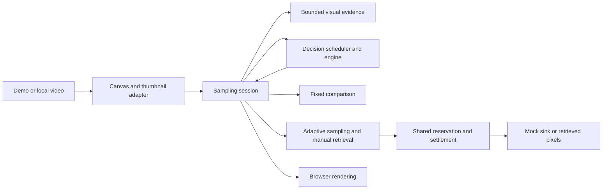

# Runtime architecture v2

SemanticStream is evolving into a budget-aware runtime for selecting evidence and coordinating inference for real-time agents. Vision, audio, text, logs, sensor readings, market events and agent messages should feed the same lifecycle. Each source needs its own capture, normalization and evidence-retention adapter.

## Ownership in Phase 3R

| Owner | Responsibility |
| --- | --- |
| Browser sources and visual adapters | Capture demo/video, own Canvas and decoder handles, produce a thumbnail and consume a borrowed Canvas synchronously. |
| `SamplingSession<T>` | Evaluate fixed and adaptive branches on the same input, own the task revision, session evidence, sampling state, decision scheduling and bounded diagnostics. It accepts typed sinks and an injected clock and runs in Node.js. |
| `DecisionEngine` | Isolate provider inputs, validate proposals, supervise primary and fallback attempt deadlines, propagate cancellation and cap unsettled calls. |
| `DecisionScheduler` | Apply cadence, cancel obsolete requests, publish results only in the active scope, and expose freshness-bounded proposals. |
| `Sampler`, `ActiveRetrievalService` | Execute synchronous delivery effects through reservation and settlement. `ContextBuffer` owns pixel copies and lookup. |
| `main.ts` | Own the browser source and DOM lifecycle, map controls to session operations and render decisions, metrics, and retrieval. |
| Benchmark runners and evaluator | Replay captured data in order, execute deterministic effects and score delivered evidence after replay. The oracle alone uses labels to schedule a reference query. |

Before Phase 3R, browser code assembled decision observations and shared mutable pending and gate flags across reset. Adaptive delivery had two real-time caps, and historical capture time fed budget audits. Now the session encloses those effects, and each delivery enters one admission path. The browser comparison keeps one fixed ledger independent of the adaptive/retrieval path. Benchmark strategies each get independent instances of the same real-time, retrieval and combined limits.

## Time and causal replay

All measurements use monotonic milliseconds on the same session clock. Media position is a separate source coordinate and may jump across seeks.

| Time | Definition |
| --- | --- |
| Capture time | The instant a source produces a frame. It supplies sampler ordering, comparison policy timing, and the retained evidence coordinate. |
| Observation time | The instant the session assembles features, available evidence and budget hints. The live session offers the current frame first. |
| Decision request start and completion | Engine entry and the instant a validated proposal or built-in fallback is available. Applicability is checked at publication and again at effect selection. |
| Retrieval request start and completion | Entry to the retrieval method and completion of synchronous lookup/copy, before returning its typed response. The response exposes both. |
| Delivery time | Successful real-time sink acceptance or successful synchronous retrieval completion. Rolling spend uses this time. A denied/error retrieval has no delivery time. |

Policy minimum spacing, fixed slots, and silence refresh are relative to the captures of accepted frames. This keeps the visual selection cadence stable. Transmission accounting uses delivery time even when a retained frame was captured much earlier. A valid clock must stay monotonic through diagnostics, reservations and commits. The two clocks injected into a live sampler for instrumentation and accounting share the same source. Replay supplies a logical tick for each capture; the current synchronous provider/sink/retrieval operations stay on that tick. A delayed simulation should explicitly advance its clock and publish observations in chronological order.

## Decision applicability

A live evaluation captures its session identity/generation, task revision, context version, request identity, observation version and time. Reset retires the scheduler and cancels pending work. A task/ROI, feature configuration or strategy change invalidates pending results and the current gate before the next frame. An adaptive acceptance advances the context version and consumes the current gate because the feature baseline changed. Budget changes take effect immediately at admission. A budget value in the observation is a hint, so a newer budget read by itself need not cancel an evaluation.

The scheduler starts at most one evaluation per active scope and accepts no queued backlog. It skips frames while a request is pending or the 100 ms interval has yet to elapse. Ordinary newer observations of the same context can coexist with the pending or latest proposal. A live proposal has an inclusive 200 ms observation age limit. Once a scope changes, a delayed completion cannot set the gate, clear a newer request or invoke its rendering callback. First-frame and silence refresh remain deterministic candidates that pass spacing and admission even when no applicable send proposal exists.

Each attempt receives a fresh signal and up to 50 ms by default. The engine validates the action, score kind, candidates and reasons for both providers. An exhausted or invalid fallback produces built-in `WAIT`. A caller cancellation skips fallback. The engine permits at most two unsettled calls per provider instance by default across live session resets. A provider that ignores abort retains its slot until settlement. Saturated attempts degrade immediately and the runtime places no more work behind them. A synchronous provider that blocks the JavaScript thread cannot be interrupted mid-call.

## Effects

| Proposal | Browser behavior | Corrected replay behavior |
| --- | --- | --- |
| `SEND_FRAME` | Can permit the next adaptive candidate in task-aware mode until consumed or expired. | Can permit the candidate on the decision tick. |
| `SEND_PREVIEW` | Uses the same frame effect and thumbnail-byte accounting as `SEND_FRAME`. | Same delivery and charge as `SEND_FRAME`. |
| `DROP`, `WAIT` | No discretionary delivery. First-frame and silence refresh remain eligible. | Same candidate rule. |
| `REQUEST_HISTORY` | Advisory. Manual timeline requests can return retained evidence through admission. | Requests a frame around 250 ms earlier, subject to lookup and budget. |
| `REQUEST_REGION` | Advisory. Manual crops go through admission on the requested buffered frame. | Requests the declared ROI at the current tick, using the full sample bounds when the task has no ROI. |
| `ESCALATE` | Advisory with no inference effect. | Counted as a proposal with no effect. The historical Phase 3A experiment mapped it to a history lookup. |

The browser and replay share proposal-to-send mapping, sampler, retrieval protocol, and evidence/accounting primitives. Their gate placement differs deliberately. The live provider completes after a capture handler and gates a subsequent frame. The current replay models an immediate rule evaluation on the same tick. Its counts should not be used as a claim about browser cadence or remote provider latency.

## Resource reservation

Admission checks a lane and the combined total atomically in one JavaScript runtime without yielding or calling adapter code. A hold immediately consumes capacity in both. It stays active until `commit(deliveredAtMs)` or `release()`. Both transitions are idempotent after the first. Rejected candidates consume nothing. The sampler releases when its sink declines or throws and advances its accepted baseline only on successful settlement. Retrieval prepares a bounded pixel copy before admission, then commits when returning a successful response. A successful response includes the post-commit budget.

Committed usage expires at exactly `deliveredAtMs + windowMs`. Holds do not expire automatically and callers must settle them. Lower caps apply to new reservations immediately and grandfather already admitted holds and committed usage. A fixed window length enables eviction without losing information needed by an expanded window. Ledger entries are bounded by the highest admitted frame capacity still outstanding within the window. Each entry consumes at least one frame and spends at identical timestamps coalesce. No live spend is truncated when a cap decreases. Simulated bytes are thumbnail or crop bytes, even when the local display sink draws the original Canvas.

Rolling transmission budgets account for frames and bytes over time. Instantaneous concurrency slots stay occupied while work is in flight. Cumulative monetary budgets will require a separate liability and usage settlement ledger. A transmission reservation represents neither an inference slot nor money.

## Extension contracts

The following boundaries describe future integration points. Implement them as concrete adapters need them.

| Contract | Responsibility |
| --- | --- |
| `StreamEvent` | Source and session identity, sequence, capture time, ingest time and an adapter-owned payload or evidence reference. Merge multiple input modalities by explicit ordering and freshness rules. |
| `ContextSnapshot` | Immutable bounded evidence references, selected per-source watermarks, task revision, and version. Evidence can be pinned or copied within budget for a request. Retrieval expansion must be explicit and produce a new snapshot revision. |
| `PerceptionDecisionProvider` | Recommend what evidence to send, defer, retrieve or summarize from a bounded observation. Rules, classifiers and Jev/Laya/AnyJev-style models can sit here. |
| `InteractionDecisionProvider` | Recommend whether/when to respond, which intent to pursue, or whether to interrupt or request more evidence. May read conversation state and an immutable snapshot. |
| `ActionExecutor` | Validate action and data, enforce capability and ownership, resolve current scope and resource availability, and translate an accepted recommendation into a bounded effect or inference task. |
| `ResourceReservation` | Hold allowed capacity for an operation and settle or release it exactly once. The ledger owns semantics for its resource kind. |

Capture, retention, ownership, deadlines, cancellation, serialization and quota checks remain deterministic runtime decisions. A provider may score or recommend an action. It cannot grant permissions, set limits, directly send data, or publish a stale result. See the [inference orchestration design](inference-orchestration-design.md) for execution and output contracts.
